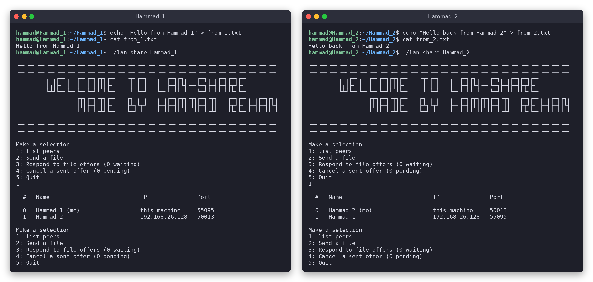
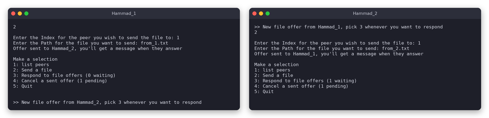
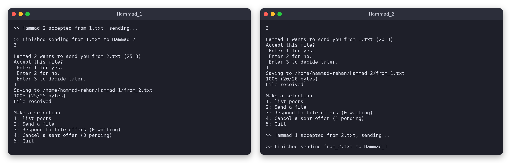
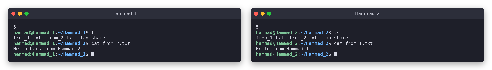

# lan-share

Send files between computers on the same network, straight from the terminal.
No server, no accounts, no setup. Start it on two machines and they find each other.

Written in C++ with plain POSIX sockets and threads.

## Demo

Two terminals, `Hammad_1` and `Hammad_2`. Each one makes a file with bash, sends it to the other, and reads what it got with `cat`.

**1. Make a file, start lan-share, and the two find each other**



**2. Both send an offer. The menu doesn't lock up while waiting for an answer**



**3. Each side accepts the other's file and it gets transferred**



**4. Quit and read the received files**



(Both terminals were on the same machine for the demo, which is why the IPs match.)

## How it works

**Finding peers (UDP).** Every instance broadcasts a small packet to `255.255.255.255:9999` every half second with its name, a random 16-byte ID and the TCP port it's listening on. A second thread listens on the same port and adds anyone new to the peer list. Your own broadcast is ignored because your ID is already in the list.

**Offering a file (TCP).** Picking a peer opens a TCP connection to the port they advertised and sends an offer: your name, the file name and its size. The wait for an answer happens on a background thread, so you can keep using the menu, send more offers, or cancel one.

**Accepting.** Incoming offers go into a queue. Answer them whenever you want: yes, no, or later. If the sender cancels before you answer, the offer disappears from your queue.

**Transfer.** On yes, the file is streamed over the same connection in 64 KB chunks. It's saved in the folder you started lan-share from.

Everything on the wire is a packed struct with numbers in network byte order:

| Message | Contents |
|---|---|
| broadcast | `LSH1` header, name, 16-byte ID, TCP port |
| offer | `Offer` header, sender name, file name, file size |
| reply | `Reply` header, 1 = yes / 0 = no |

### A few safety things
- Received file names are stripped of any path, so a sender can't write outside your folder.
- Existing files are never overwritten. A duplicate becomes `1_name`, `2_name` and so on.
- A failed transfer deletes the half-written file.
- A peer that goes silent for 10 seconds gets dropped instead of hanging the program.

## Build and run

Linux only.

```
make
./lan-share <your name> [debug] [broadcast delay ms]
```

```
./lan-share Hammad_1              # normal
./lan-share Hammad_1 yes          # debug mode: shows peer IDs and full offer details
./lan-share Hammad_1 no 1000      # broadcast once a second instead of every 500 ms
```

Menu:

```
1: list peers
2: Send a file
3: Respond to file offers
4: Cancel a sent offer
5: Quit
```

## Files

- `lan-share.cpp` – the whole program
- `queue.h` – linked-list queue used for incoming offers

## Known limitations

- Peers that quit stay in the list until you restart.
- Nothing is encrypted or authenticated. Anyone on the network can see a transfer or pretend to be a peer.
- Broadcast only reaches your own subnet, and some networks (public Wi-Fi, some campus networks) block it.

---

Made by Hammad Rehan
